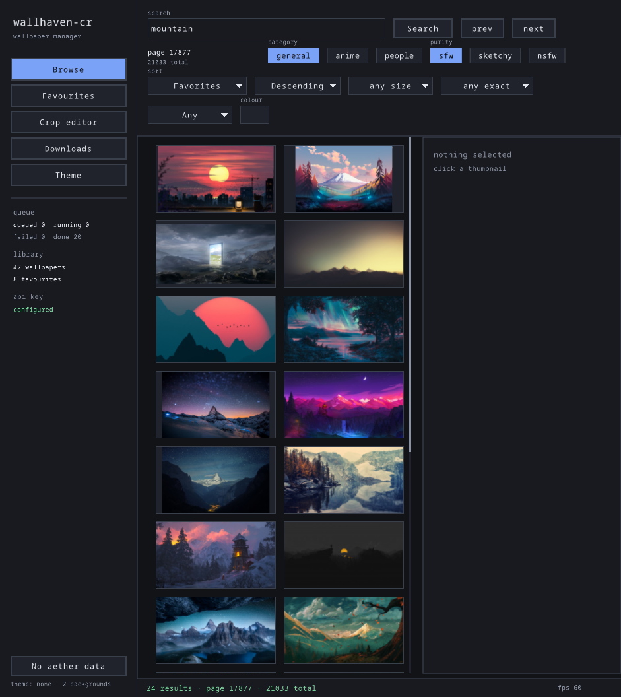
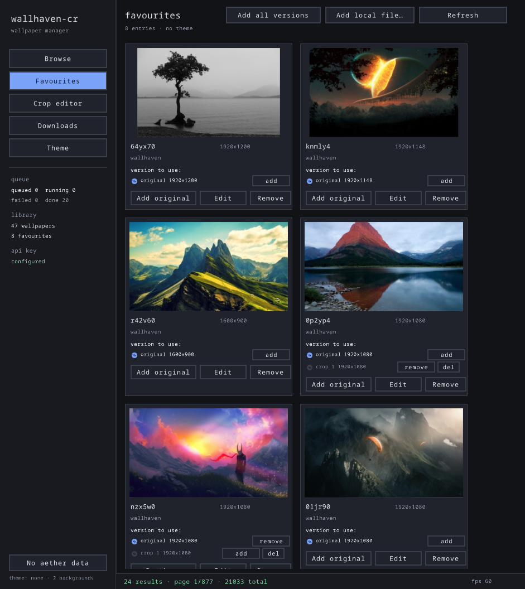
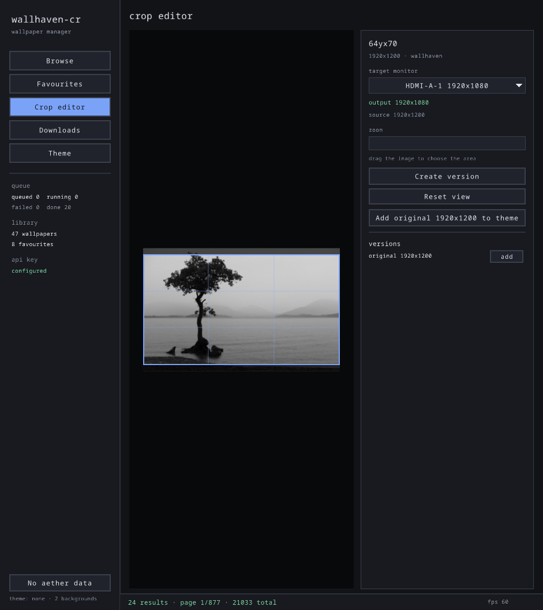

# wallhaven-cr

Wallpaper manager for [Omarchy](https://omarchy.org), written in Crystal with an
immediate-mode GUI (raylib + raygui). No GTK, no Qt, no webview.

## Features

* Browse wallhaven.cc with the full search surface: categories (general / anime /
  people), purity (SFW / sketchy / NSFW), sorting and order, toplist range,
  `atleast` minimum size, exact resolutions, aspect ratio and colour filter.
* Favourites are downloaded in the background (durable SQLite job queue) and get
  whole-image thumbnails — aspect preserved, never cropped, never stretched.
* Crop editor: zoom and drag the image under a frame locked to the target
  monitor's aspect ratio, then write a version at exactly that monitor's size.
* Every wallpaper keeps its original plus any number of cropped versions; each
  version is a separate row and can be deleted on its own.
* Add any version to the current Omarchy theme, and remove it again from the
  Favourites grid, Browse, or the Theme view. Adding is idempotent.
* Add wallpapers that are already on disk.

## Screenshots

Browse wallhaven with the full search surface, against the local library:



Favourites as cards, one row per version, with the version to add to the theme
and the theme chips:



The crop editor, framed to the target monitor:



## Requirements

* Crystal >= 1.15 (built and tested with 1.21)
* `raylib` (5.5) and `raygui` (4.0) — raylib from the AUR/`raylib` package or a
  local install in `~/.local`; raygui is built from `raysan5/raygui` as
  `libraygui.so` (see `Makefile`)
* libvips (`vips`) **or** ImageMagick for thumbnails, previews and cropping —
  libvips is preferred when installed (faster and far less memory per image;
  set `WALLHAVEN_CR_IMAGE_TOOL=magick` to force the fallback)
* Hyprland (`hyprctl`) for monitor geometry; falls back to 1920x1080
* Optionally Omarchy, for the theme integration

## Build

```sh
make            # builds bin/wallhaven-cr
make run        # builds and starts the GUI
make test       # runs the specs
```

## Usage

```sh
wallhaven-cr                       # GUI
wallhaven-cr --search -q anime -c 010 -p 100 --pages 2 --json
wallhaven-cr --download ID         # queue a download
wallhaven-cr --convert ID          # queue a monitor-sized version (centred crop)
wallhaven-cr --import-local PATH   # add an image from disk to favourites
wallhaven-cr --import-aether       # queue the old Aether favourites
wallhaven-cr --drain               # run queued jobs to completion
wallhaven-cr --monitors            # Hyprland monitors and their pixel sizes
wallhaven-cr --stats               # library and queue counts
wallhaven-cr --capture PATH        # render one frame to a PNG (--frames, --view)
wallhaven-cr --version             # version plus the build time of this binary
```

In the GUI: left click selects, right click toggles the favourite, scroll wheel
scrolls, `Escape` closes the file picker and any open dropdown or colour picker,
`Ctrl+Q` quits.

## Data

| Path | Contents |
|---|---|
| `~/.local/share/wallhaven-cr/wallhaven.db` | wallpapers, versions, job queue |
| `~/.local/share/wallhaven-cr/originals/` | downloaded / imported originals |
| `~/.local/share/wallhaven-cr/crops/` | cropped + monitor-sized versions |
| `~/.local/share/wallhaven-cr/thumbs/` | grid thumbnails and editor previews |
| `~/.config/wallhaven-cr/config.json` | API key and last used filters |
| `~/.config/omarchy/backgrounds/<theme>/` | wallpapers added to the theme |

The API key is seeded from `~/.config/aether/wallhaven.json` on first run, so an
existing wallhaven key keeps working. NSFW purity needs a key.

## Development

See [AGENTS.md](AGENTS.md) for the architecture, the invariants that must not be
broken (GL thread pinning, `posix_spawnp` instead of `fork`, per-thread SQLite
connections, atomic writes), and how to verify a change without a window.
